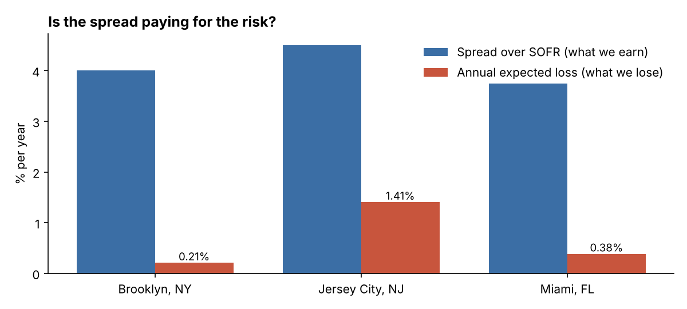

# Bridge Loan Credit Model

A Monte Carlo credit model for commercial real estate bridge loans. Give it a deal, and it answers the question a bridge lender's credit committee actually asks:

> **If we make this loan, how likely are we to lose money, how much, and is the spread worth it?**

It produces probability of default (PD), loss given default (LGD), expected loss (EL), credit VaR, the largest loan size the model would approve, and a one-page credit memo per deal. An optional AI layer turns raw listing text into deal inputs.



| Market | Loan | LTC | PD | Annual EL | Call | Max loan for approve |
|---|---|---|---|---|---|---|
| Brooklyn, NY | $6.40M | 75% | 2.6% | 0.21% | APPROVE | $6.66M |
| Jersey City, NJ | $13.40M | 77% | 17.9% | 1.41% | DECLINE AS STRUCTURED | $11.89M |
| Miami, FL | $13.20M | 72% | 4.6% | 0.38% | APPROVE WITH CONDITIONS | $13.18M |

Credit memos: [Brooklyn](output/brooklyn_multifamily_memo.md) · [Jersey City](output/jersey_city_mixed_use_memo.md) · [Miami](output/miami_multifamily_memo.md)

*The three deals are illustrative: realistic but hypothetical, not real listings. Rates are as of November 2026 (SOFR 3.95%, 10-year Treasury 4.95%).*

---

## The story of a bridge loan

A bridge loan funds a property that isn't ready for a cheap long-term loan yet: it's half empty, needs renovation, or rents are below market. The borrower's plan is to buy it, fix it, lease it up, and then pay off the bridge loan by **refinancing** into a permanent loan or **selling**.

So the lender is betting on the exit. It doesn't matter much whether the building covers interest today (it usually doesn't; that's what the interest reserve is for). What matters is whether, 24 to 36 months from now, someone else will take the lender out at full value.

The finding that shows up across all three deals: **at a 6.7% permanent-loan rate, none of them can refinance out on business-plan numbers.** The takeout lender's DSCR test is the binding constraint every time, so the lender's real exit is a sale. That makes exit cap rates, not today's cash flow, the dominant risk. It's the "refi wall" problem in CRE right now, falling out of the model rather than assumed into it.

## How the model works

**1. Underwriting (deterministic).** `bridgeloan/metrics.py` computes the standard sizing metrics as-is and as-stabilized, sizes the takeout loan, and finds breakevens: the exit cap rate at which a sale stops repaying the loan, and the NOI needed for a clean refi.

**2. Monte Carlo stress test.** `bridgeloan/simulate.py` runs 10,000 paths. On each one:

- **SOFR** follows a mean-reverting (Vasicek) process month by month. It sets what the borrower pays now.
- **The 10-year Treasury** follows a random walk with shocks correlated (ρ = 0.6) to SOFR's. It sets the permanent-loan rate at exit.
- **Exit cap rates** move with the 10-year (β = 0.5, so +100bp in Treasuries moves caps +50bp), plus a property-specific shock.
- **The business plan slips.** Stabilization is delayed by D months (Gamma distributed, mean set per deal) and the building earns a fraction *a* of promised NOI (Normal, mean and sd set per deal).
- **Carry.** Each month, interest the NOI doesn't cover comes out of the interest reserve, then sponsor cash. Running out before maturity is a **term default**.
- **Maturity.** Try refi, then sale, then extension (if the in-place debt yield passes the extension test). If none work: **maturity default**.
- **Loss.** On default the lender forecloses, waits through the state's foreclosure timeline (NY/NJ/FL are all judicial and slow), collects receiver rent in the meantime, sells at a discount, and discounts the recovery back at the loan rate.

**3. Sensitivities.** Each input is shocked one at a time using the *same random draws* as the base case (common random numbers), so changes in PD and EL are caused by the shock, not by simulation noise.

**4. Decision.** An explicit, illustrative screening rule turns the numbers into a call, and a bisection search finds the largest loan that still gets an unconditional approve. That's the number a credit officer would hand back to the originator: "we can do this at $X, not $Y."

## Glossary: every variable

| Term | Meaning |
|---|---|
| **NOI** | Net Operating Income: rent minus operating expenses, before debt payments. The cash the building generates per year. |
| **Cap rate** | NOI / value. Value = NOI / cap rate, so higher cap rates mean lower values. Cap rates rise when interest rates rise. |
| **LTV** | Loan-to-Value = loan / property value. |
| **LTC** | Loan-to-Cost = loan / (price + renovation + closing costs). 1 − LTC is the sponsor's equity. |
| **DSCR** | Debt Service Coverage Ratio = NOI / annual debt payments. 1.25x means NOI is 25% more than the mortgage. |
| **Debt yield** | NOI / loan. What the lender would earn if it owned the building. Ignores interest rates, which is why lenders use it as a sanity check. |
| **Mortgage constant (k)** | Annual payment per $1 borrowed on an amortizing loan. |
| **SOFR** | Secured Overnight Financing Rate, the floating benchmark bridge loans are priced over. |
| **Spread** | What the lender charges above SOFR. Bridge loan rate = SOFR + spread. |
| **Future funding** | Part of the loan held back and released as renovation work is done. |
| **Interest reserve** | Cash set aside at closing to pay interest while NOI is too low. |
| **Rate cap** | An option the borrower buys that pays out if SOFR rises above the strike. Keeps the borrower's cost bounded. |
| **Takeout loan** | The permanent loan that refinances the bridge loan. Sized as the minimum of the LTV, DSCR and debt-yield limits. |
| **PD** | Probability of default: share of simulated paths that default. |
| **LGD** | Loss given default: average loss on defaulted paths, as % of the loan. |
| **EL** | Expected loss = average loss across all paths ≈ PD × LGD. Annualized by dividing by the average life of the loan. |
| **Credit VaR (99%)** | The loss exceeded on only 1% of paths. |
| **Risk-adjusted margin** | Spread + fees per year − annual expected loss. What the lender actually earns for the risk. |

## Key assumptions and why

| Assumption | Value | Why |
|---|---|---|
| Takeout max LTV / min DSCR / min debt yield | 70% / 1.25x / 8% | Typical agency and life-company multifamily sizing. |
| Perm loan rate | 10y Treasury + 1.75%, 30-yr amortization | In line with current agency/CMBS fixed-rate spreads. |
| Cap rate beta to 10y | 0.5 | Cap rates historically move less than one-for-one with Treasuries because spreads compress and widen. |
| SOFR vol / reversion | 1.00% / 0.5 per year | Gives a realistic range for a 2-3 year horizon without negative rates. |
| NOI attainment | mean 92-95%, sd 8-12% | Business plans are optimistic. Miami gets the widest band because insurance and post-Surfside reserve costs swing expenses. |
| Liquidation cost | 10-12% | Legal, receiver, broker, and distressed-sale discount. |
| Foreclosure timeline | NY/NJ 30 months, FL 20 months | All three are judicial foreclosure states; NY and NJ are among the slowest in the country. |

## Limitations

- No cash-in refinance: if the takeout loan is short, the model assumes the sponsor can't write a check for the gap. Real sponsors sometimes do, so maturity PD is conservative.
- Capex overruns aren't modeled separately; they show up only indirectly through delay and NOI attainment.
- Correlations between NOI performance and rates are not modeled (in a recession both go wrong together, which would fatten the tail).
- The screening thresholds are illustrative, not any institution's actual credit policy.

## Run it

```bash
pip install -r requirements.txt
python run.py                                  # all deals -> output/
python run.py deals/miami_multifamily.yaml     # one deal
pytest                                         # tests

# AI listing extraction (optional; falls back to regex without an API key)
export ANTHROPIC_API_KEY=...
python -m bridgeloan.extract listings/sample_listing.txt > deals/my_deal.yaml
```

To screen a new deal, copy one of the YAML files in `deals/`, edit the numbers, update `rates:` to today's SOFR and 10-year Treasury, and run.

## Repo layout

```
bridgeloan/
  deal.py       deal + market inputs
  metrics.py    LTV, LTC, DSCR, debt yield, takeout sizing, breakevens
  simulate.py   Monte Carlo engine, sensitivities, verdict, max-loan solver
  extract.py    listing text -> deal terms (Claude API or regex)
  memo.py       credit memo writer
  charts.py     charts
deals/          deal inputs (YAML)
listings/       sample listing text for the extractor
output/         generated memos and charts
tests/          unit + sanity tests
```
