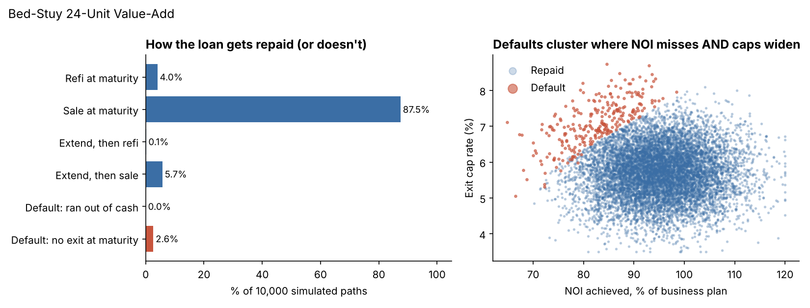

# Credit Memo: Bed-Stuy 24-Unit Value-Add

**Brooklyn, NY | Multifamily (walk-up) | 24 units**
Rates as of 2026-11: SOFR 3.95%, 10y Treasury 4.95%.
*Illustrative deal for a modeling project. Not a real transaction.*

## Recommendation: APPROVE

Low default probability and expected loss eats under 10% of the spread. Model supports up to **$6.66M** (78% LTC) for an unconditional approve. Requested: $6.40M (75% LTC).

| | |
|---|---|
| Probability of default (PD) | **2.6%** (0.0% during term, 2.6% at maturity) |
| Loss given default (LGD) | 16.4% of balance |
| Expected loss, life of loan | 0.43% |
| Expected loss, annualized | 0.21% vs. 4.00% spread |
| Risk-adjusted margin | 4.51% / yr (spread + fees - expected loss) |
| 99% credit VaR | 17.5% of commitment |

## The deal

Sponsor buys a 24-unit walk-up with below-market rents, renovates units on turnover, and pushes rents to market. Assumes units are free-market. If any are rent-stabilized, post-2019 HSTPA rules sharply limit the rent upside and this business plan does not work.

| Sources & uses | |
|---|---|
| Purchase price | $7.20M |
| Capex budget | $1.20M |
| Closing costs | $0.15M |
| **Total cost** | **$8.55M** |
| Loan: funded at close | $5.40M |
| Loan: future funding (capex) | $1.00M |
| Sponsor equity | $2.15M (25% of cost) |

Terms: SOFR + 4.00% (floor 2.00%), 24 months + 12-month extension, 1.0 pt in / 0.5 pt out. Interest reserve $0.15M.

## Sizing metrics

| Metric | Today (as-is) | Stabilized (business plan) |
|---|---|---|
| NOI | $0.38M | $0.52M |
| Loan-to-value (LTV) | 75.0% | 70.8% |
| Debt yield (NOI / loan) | 7.00% | 8.12% |
| DSCR on bridge interest | 0.88x | 1.02x |

Today's NOI does not cover interest (shortfall about $0.05M/yr; reserve covers ~35 months at today's draw).

## Exit analysis: who takes us out?

At today's permanent-loan rate of 6.70% (10y Treasury 4.95% + 1.75%), a takeout lender sizes to $5.37M, constrained by **DSCR**. That is **$1.03M short** of our $6.40M balance, so even if the business plan is hit exactly, a refinance alone does not repay us. The realistic exit is a **sale** (or a cash-in refi by the sponsor). The building would need to earn $0.62M of NOI to refi us out cleanly, 19% above the business plan.

A sale repays us as long as the exit cap rate stays below **7.96%**, versus 5.75% underwritten: a **221bp cushion**.

## Stress test (10,000 Monte Carlo paths)

Each path simulates SOFR and the 10-year Treasury month by month, moves cap rates with Treasuries, delays the business plan, and shortchanges NOI, then tests refi / sale / extension at maturity.

Outcomes: repaid by refi 4.2%, repaid by sale 93.2%, default 2.6%.

| Scenario | PD | Expected loss |
|---|---|---|
| Base case | 2.6% | 0.43% |
| Exit cap +50bp | 7.4% | 1.20% |
| Exit cap +100bp | 17.0% | 2.75% |
| NOI attainment -10pts | 13.3% | 2.33% |
| Lease-up delay +6 months | 3.2% | 0.51% |
| 10y +100bp (perm rate up, caps follow) | 7.4% | 1.20% |
| SOFR +150bp | 2.8% | 0.52% |
| No sponsor support | 10.9% | 0.66% |

Biggest single sensitivity: **Exit cap +100bp** takes expected loss from 0.43% to 2.75%.

## Conditions / what would change my mind

- Exit is sale-dependent while the perm rate sits near 6.7%. Confirm sale comps support a 5.75% cap.
- Extension test: in-place debt yield of at least 6.5%. Consider tightening if PD at maturity is the main risk.
- Verify sponsor liquidity of $0.25M with bank statements; the model leans on it to cover carry.
- Rate cap at 5.00% SOFR strike required for the full term including extension.
