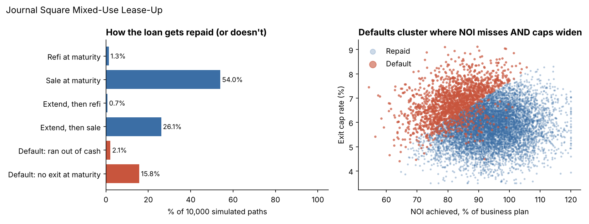

# Credit Memo: Journal Square Mixed-Use Lease-Up

**Jersey City, NJ | Mixed-use (40 apartments over ground-floor retail) | 40 units**
Rates as of 2026-11: SOFR 3.95%, 10y Treasury 4.95%.
*Illustrative deal for a modeling project. Not a real transaction.*

## Recommendation: DECLINE AS STRUCTURED

Expected loss consumes too much of the spread or default probability is too high. Needs a lower loan amount. Model supports up to **$11.89M** (69% LTC) for an unconditional approve. Requested: $13.40M (77% LTC).

| | |
|---|---|
| Probability of default (PD) | **17.9%** (2.1% during term, 15.8% at maturity) |
| Loss given default (LGD) | 19.2% of balance |
| Expected loss, life of loan | 3.43% |
| Expected loss, annualized | 1.41% vs. 4.50% spread |
| Risk-adjusted margin | 3.71% / yr (spread + fees - expected loss) |
| 99% credit VaR | 31.9% of commitment |

## The deal

Newly renovated building, 55% leased on the residential side, ground-floor retail fully vacant. Sponsor needs to lease residential and sign two retail tenants. Aggressive leverage: ~77% loan-to-cost and the building does not cover interest today.

| Sources & uses | |
|---|---|
| Purchase price | $14.50M |
| Capex budget | $2.50M |
| Closing costs | $0.30M |
| **Total cost** | **$17.30M** |
| Loan: funded at close | $11.40M |
| Loan: future funding (capex) | $2.00M |
| Sponsor equity | $3.90M (23% of cost) |

Terms: SOFR + 4.50% (floor 2.00%), 24 months + 12-month extension, 1.0 pt in / 0.5 pt out. Interest reserve $0.60M.

## Sizing metrics

| Metric | Today (as-is) | Stabilized (business plan) |
|---|---|---|
| NOI | $0.58M | $1.05M |
| Loan-to-value (LTV) | 78.6% | 76.6% |
| Debt yield (NOI / loan) | 5.09% | 7.84% |
| DSCR on bridge interest | 0.60x | 0.93x |

Today's NOI does not cover interest (shortfall about $0.38M/yr; reserve covers ~19 months at today's draw).

## Exit analysis: who takes us out?

At today's permanent-loan rate of 6.70% (10y Treasury 4.95% + 1.75%), a takeout lender sizes to $10.85M, constrained by **DSCR**. That is **$2.55M short** of our $13.40M balance, so even if the business plan is hit exactly, a refinance alone does not repay us. The realistic exit is a **sale** (or a cash-in refi by the sponsor). The building would need to earn $1.30M of NOI to refi us out cleanly, 24% above the business plan.

A sale repays us as long as the exit cap rate stays below **7.68%**, versus 6.00% underwritten: a **168bp cushion**.

## Stress test (10,000 Monte Carlo paths)

Each path simulates SOFR and the 10-year Treasury month by month, moves cap rates with Treasuries, delays the business plan, and shortchanges NOI, then tests refi / sale / extension at maturity.

Outcomes: repaid by refi 2.0%, repaid by sale 80.1%, default 17.9%.

| Scenario | PD | Expected loss |
|---|---|---|
| Base case | 17.9% | 3.43% |
| Exit cap +50bp | 30.7% | 6.20% |
| Exit cap +100bp | 46.4% | 9.87% |
| NOI attainment -10pts | 40.9% | 9.09% |
| Lease-up delay +6 months | 23.4% | 4.06% |
| 10y +100bp (perm rate up, caps follow) | 30.7% | 6.20% |
| SOFR +150bp | 29.7% | 4.53% |
| No sponsor support | 40.8% | 5.16% |

Biggest single sensitivity: **Exit cap +100bp** takes expected loss from 3.43% to 9.87%.

## Conditions / what would change my mind

- Exit is sale-dependent while the perm rate sits near 6.7%. Confirm sale comps support a 6.00% cap.
- Extension test: in-place debt yield of at least 6.5%. Consider tightening if PD at maturity is the main risk.
- Verify sponsor liquidity of $0.40M with bank statements; the model leans on it to cover carry.
- Rate cap at 5.00% SOFR strike required for the full term including extension.
