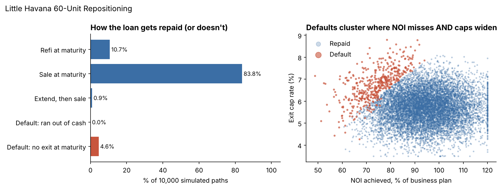

# Credit Memo: Little Havana 60-Unit Repositioning

**Miami, FL | Multifamily (1970s garden) | 60 units**
Rates as of 2026-11: SOFR 3.95%, 10y Treasury 4.95%.
*Illustrative deal for a modeling project. Not a real transaction.*

## Recommendation: APPROVE WITH CONDITIONS

Pricing covers expected loss, but default risk is material. Tighten structure (lower leverage, bigger reserve, stronger extension test). Model supports up to **$13.18M** (72% LTC) for an unconditional approve. Requested: $13.20M (72% LTC).

| | |
|---|---|
| Probability of default (PD) | **4.6%** (0.0% during term, 4.6% at maturity) |
| Loss given default (LGD) | 17.1% of balance |
| Expected loss, life of loan | 0.79% |
| Expected loss, annualized | 0.38% vs. 3.75% spread |
| Risk-adjusted margin | 4.10% / yr (spread + fees - expected loss) |
| 99% credit VaR | 22.0% of commitment |

## The deal

1970s garden-style complex. Sponsor renovates interiors and common areas. Key risk is expenses, not rents: Florida property insurance and post-Surfside structural/reserve requirements can erase NOI growth. Modeled as wider NOI uncertainty.

| Sources & uses | |
|---|---|
| Purchase price | $16.00M |
| Capex budget | $2.00M |
| Closing costs | $0.30M |
| **Total cost** | **$18.30M** |
| Loan: funded at close | $11.50M |
| Loan: future funding (capex) | $1.70M |
| Sponsor equity | $5.10M (28% of cost) |

Terms: SOFR + 3.75% (floor 2.00%), 24 months + 12-month extension, 1.0 pt in / 0.5 pt out. Interest reserve $0.25M.

## Sizing metrics

| Metric | Today (as-is) | Stabilized (business plan) |
|---|---|---|
| NOI | $0.80M | $1.12M |
| Loan-to-value (LTV) | 71.9% | 67.8% |
| Debt yield (NOI / loan) | 6.96% | 8.48% |
| DSCR on bridge interest | 0.90x | 1.10x |

Today's NOI does not cover interest (shortfall about $0.09M/yr; reserve covers ~35 months at today's draw).

## Exit analysis: who takes us out?

At today's permanent-loan rate of 6.70% (10y Treasury 4.95% + 1.75%), a takeout lender sizes to $11.57M, constrained by **DSCR**. That is **$1.63M short** of our $13.20M balance, so even if the business plan is hit exactly, a refinance alone does not repay us. The realistic exit is a **sale** (or a cash-in refi by the sponsor). The building would need to earn $1.28M of NOI to refi us out cleanly, 14% above the business plan.

A sale repays us as long as the exit cap rate stays below **8.32%**, versus 5.75% underwritten: a **257bp cushion**.

## Stress test (10,000 Monte Carlo paths)

Each path simulates SOFR and the 10-year Treasury month by month, moves cap rates with Treasuries, delays the business plan, and shortchanges NOI, then tests refi / sale / extension at maturity.

Outcomes: repaid by refi 10.7%, repaid by sale 84.7%, default 4.6%.

| Scenario | PD | Expected loss |
|---|---|---|
| Base case | 4.6% | 0.79% |
| Exit cap +50bp | 9.3% | 1.62% |
| Exit cap +100bp | 17.0% | 3.01% |
| NOI attainment -10pts | 15.1% | 2.85% |
| Lease-up delay +6 months | 4.8% | 0.81% |
| 10y +100bp (perm rate up, caps follow) | 9.3% | 1.62% |
| SOFR +150bp | 4.7% | 0.88% |
| No sponsor support | 11.8% | 0.95% |

Biggest single sensitivity: **Exit cap +100bp** takes expected loss from 0.79% to 3.01%.

## Conditions / what would change my mind

- Exit is sale-dependent while the perm rate sits near 6.7%. Confirm sale comps support a 5.75% cap.
- Extension test: in-place debt yield of at least 6.5%. Consider tightening if PD at maturity is the main risk.
- Verify sponsor liquidity of $0.50M with bank statements; the model leans on it to cover carry.
- Rate cap at 5.00% SOFR strike required for the full term including extension.
